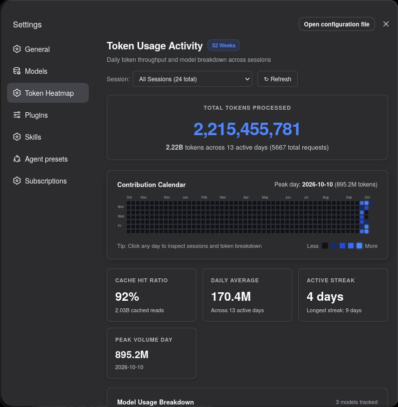
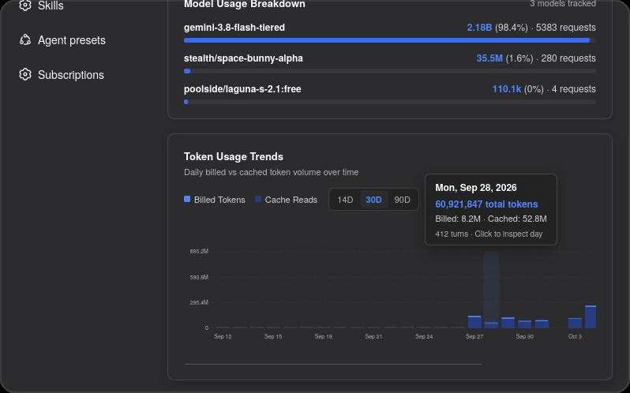

# token-contribution

> GitHub-style daily token usage contribution calendar, model analytics, and timeline trends for [DeepSeek Harness](https://github.com/deepseek-ai/dsh).

---

## Installation

Install with a single command via the official DSH CLI:

```bash
dsh plugin --profile web add token-contribution
```

*(To remove later: `dsh plugin --profile web remove token-contribution`)*

### Manual Alternative (pnpm)

```bash
cd ~/.dsh/profiles/web
pnpm add token-contribution
```
Then add `"token-contribution"` to `bundles` in `~/.dsh/profiles/web/package.json`.

---

## Preview

<p align="center">
  
  &nbsp;
  
</p>

---

## Features

- **52-Week GitHub Contribution Calendar:** 7 rows × 52 columns tracking daily token activity with a smooth monochromatic gradient anchored on DeepSeek's official brand blue (`#3964FE`).
- **Interactive Day Inspector:** Click on any day to slide open an inspection drawer showing every session active on that date, exact timestamps, and token breakdown.
- **Top Model Usage Breakdown:** Real-time distribution showing tokens, percentages, and request steps for every model used across sessions.
- **Token Usage Trends Timeline:** Stacked bar chart comparing daily Billed Tokens vs. Cache Reads, with **14D / 30D / 90D** range filters and hover tooltips.
- **Global & Per-Session Filtering:** Toggle between aggregate global history or inspect token activity for individual sessions.
- **Auto-Expanding Panel:** Smoothly widens the DSH Settings dialog to 1180px so the calendar and charts fit cleanly with zero scrollbars.
- **Session Token Meter Integration:** Injects a clean action button into the in-session token usage dialog to open the heatmap directly from active sessions.
- **High-Performance Parser:** Recursively aggregates local `.jsonl.zstd` logs with timestamp and mtime caching for instant loading.

---

## Usage

1. Open the DeepSeek Harness Web GUI (`http://127.0.0.1:3080`).
2. Go to **Settings** (gear icon at the bottom left) → **Token Heatmap**.
3. Or during any session, click on the token stats pill at the bottom of the composer and tap **"View Token Usage Heatmap →"**.

---

## License

MIT © [oiupoyt](https://git.oiupoyt.space/oiupoyt)
